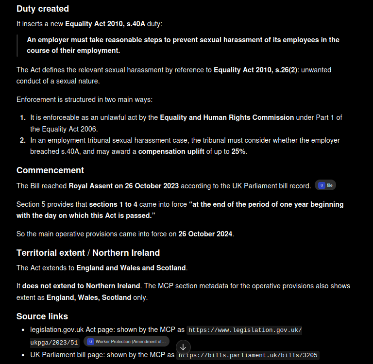
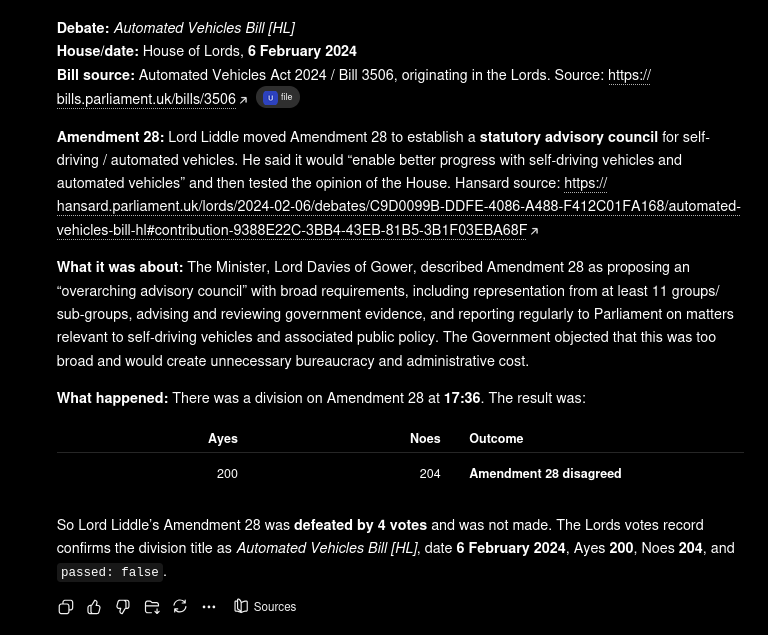

# uk-legal-mcp

<!-- mcp-name: io.github.paulieb89/uk-legal-mcp -->

[](https://pypi.org/project/uk-legal-mcp/)
[](https://safeskill.dev/scan/paulieb89-uk-legal-mcp)
[](https://glama.ai/mcp/connectors/io.github.paulieb89/uk-legal-mcp)
[](https://smithery.ai/servers/bouch/uk-legal)
[](https://vscode.dev/redirect/mcp/install?name=uk-legal&config=%7B%22type%22%3A%22http%22%2C%22url%22%3A%22https%3A%2F%2Fuk-legal-mcp.fly.dev%2Fmcp%22%7D)
[](https://insiders.vscode.dev/redirect/mcp/install?name=uk-legal&config=%7B%22type%22%3A%22http%22%2C%22url%22%3A%22https%3A%2F%2Fuk-legal-mcp.fly.dev%2Fmcp%22%7D&quality=insiders)
[](https://cursor.com/en/install-mcp?name=uk-legal&config=eyJ0eXBlIjoiaHR0cCIsInVybCI6Imh0dHBzOi8vdWstbGVnYWwtbWNwLmZseS5kZXYvbWNwIn0=)

UK legal research sources for your AI assistant.

uk-legal-mcp connects ChatGPT, Claude, VS Code, Cursor, and other MCP-aware clients to UK case law, legislation, Hansard, bills, votes, committees, OSCOLA citation parsing, and HMRC guidance. It returns primary source text and citation metadata so your agent can build evidence packs you can check and footnote.

No API keys are required for the legal sources. HMRC's authenticated Making Tax Digital endpoint is optional.

For best results, tell your assistant to use the `uk-legal-mcp` server and not to answer from memory when a UK legal source can be checked.

---

## Connect

Hosted endpoint — no install, no API key:

```text
https://uk-legal-mcp.fly.dev/mcp
```

### Claude (web, desktop and mobile)

1. Open **Customize → Connectors** ([claude.ai/customize/connectors](https://claude.ai/customize/connectors)).
2. Click **Add custom connector**.
3. Name it `uk-legal`, paste the URL above and click **Add**. No sign-in is needed.

That's it — no config file to edit and no restart. Add the connector on web or desktop, and it's then available on your account, including the mobile apps. Turn it on or off per chat from the **+** menu → **Connectors**. On Team and Enterprise plans an Owner adds it once under **Organization settings → Connectors**; Free plans can add one custom connector.

### Claude Code

If you've added the connector above, Claude Code lists it under `/mcp` — but only when Claude Code is signed in with your claude.ai subscription login, not an API key. Otherwise, add it directly:

```bash
claude mcp add --transport http --scope user uk-legal https://uk-legal-mcp.fly.dev/mcp
```

### Other clients

VS Code and Cursor: use the install badges at the top of this page. For clients configured with `mcpServers` JSON:

```json
{
  "mcpServers": {
    "uk-legal": {
      "type": "http",
      "url": "https://uk-legal-mcp.fly.dev/mcp"
    }
  }
}
```

### Run it locally (stdio)

Local mode uses your own IP rather than a shared cloud IP, which can be more reliable for very large Acts.

Claude Code:

```bash
claude mcp add --scope user uk-legal -- uvx uk-legal-mcp
```

<details>
<summary>Claude Desktop and other <code>mcpServers</code> clients</summary>

Claude Desktop runs local servers either as a packaged desktop extension (`.mcpb`, installed from **Settings → Extensions**) or from `claude_desktop_config.json`. There's no `.mcpb` for this server yet, so for local mode add this to the config file (**Settings → Developer → Edit Config**) and restart the app. For everyday use the hosted connector above is simpler.

```json
{
  "mcpServers": {
    "uk-legal": {
      "command": "uvx",
      "args": ["uk-legal-mcp"]
    }
  }
}
```

</details>

If a hosted tool stops responding, refresh the server from your client's connector settings (in Claude, **Customize → Connectors**).

---

## Try This First

After connecting the server, start a fresh chat and ask:

```text
I am checking a UK legal source. Only use uk-legal-mcp. Find the source, give me the source URL, and tell me what metadata I should check before relying on it.
```

For legal work, ask for an evidence pack rather than a bare answer:

```text
Only use uk-legal-mcp. Give me the source text or source summary, the source URL, citation metadata, and any caveats about jurisdiction, version, or uncertainty.
```

See [the lawyer guide](docs/lawyer-guide.md) for ready-to-run prompts.

---

## What It Covers

| Source area | What your assistant can check |
|---|---|
| Case law | UK judgments from TNA Find Case Law, including neutral citations, court, date, judgment metadata, paragraph reads, and in-judgment search. |
| Legislation | Acts and Statutory Instruments from legislation.gov.uk, including tables of contents, sections, territorial extent, in-force signals, and point-in-time reads. |
| Parliament | Hansard debates and contributions, debate-to-division chains, member biographies, column references, and petitions. |
| Bills | Parliamentary Bills, stages, sponsors, publications, and bill history. |
| Votes | Commons and Lords divisions, counts, results, and per-member voting records. |
| Committees | Select committees, memberships, oral evidence, and written evidence. |
| Citations | OSCOLA-style citation parsing and resolution to canonical sources. |
| HMRC | VAT rate lookups, GOV.UK HMRC guidance search, and MTD VAT status checks on self-hosted instances with production HMRC credentials (not offered on the hosted endpoint). |

The server also exposes `judgment://`, `legislation://`, and `hansard://` resources for source text that is too large to return in a single search result.

Full details are in the [tool reference](docs/tool-reference.md) and [upstream API reference](docs/api-reference.md).

---

## Examples

**Legislation check:** the assistant finds the Worker Protection Act duty, commencement position, territorial extent, and source links.



**Parliamentary evidence:** the assistant follows a House of Lords debate into a division result for an Automated Vehicles Bill amendment.



More examples are in the [lawyer guide](docs/lawyer-guide.md).

---

## Using It Safely

uk-legal-mcp helps your AI assistant find and quote UK legal sources. It does not replace legal judgement.

- **Check jurisdiction.** Legislation can apply differently in England, Wales, Scotland, and Northern Ireland. When reading a section, check the `extent` field before relying on it.
- **Check whether a provision is current.** Some sections may be repealed, amended, prospective, or not yet in force. The server returns in-force and version-date information where the source provides it.
- **Verify citations before relying on them.** Ask the agent to resolve case citations and Hansard volume/column references against the primary source.
- **Separate exact matches from nearby candidates.** Case names and party names can be similar. A good answer should say which source was verified and which candidates were merely related.
- **Treat the result as an evidence pack.** The server returns primary source text and citation metadata. Your agent can summarise it, but you decide how the law applies.

---

## For Developers

Run the streamable HTTP server locally:

```bash
python -m src.gateway
```

Run the declarative FastMCP manifest for inspection/dev tooling:

```bash
fastmcp run
fastmcp inspect
```

`fastmcp run` is for inspection/dev only — it wraps the FastMCP runner directly and skips the production uvicorn shape (`_AcceptNormalizer`, `proxy_headers`) that `python -m src.gateway` wires for the Fly deployment. The server answers `GET /mcp` with a native 405 (stateless, POST-only), so use `python -m src.gateway` for anything prod-like.

Use a local checkout over stdio:

```json
{
  "mcpServers": {
    "local-uk-legal": {
      "command": "uv",
      "args": ["run", "--project", "<abs-path>", "uk-legal-mcp"],
      "env": { "VIRTUAL_ENV": "" }
    }
  }
}
```

Release notes live in [CHANGELOG.md](CHANGELOG.md).
